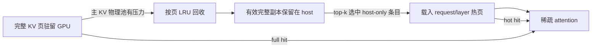

KVDuo 是面向原生稀疏注意力模型的 KV Cache 管理方案。它优先让完整 KV 驻留在 GPU；只有主稀疏 KV 物理池出现分配压力时，才回收已有最新 host 副本的冷页。稀疏注意力再次选中这些页中的条目时，resolver 按 layer 将条目载入 GPU 热页。

这种设计将普通 decode 保持在完整 KV 路径上，并在显存不足后切换为完整页、host 副本和按层热条目共存的混合驻留，从而减少整请求 retract 后重复 prefill 的开销。

## 内存模型

### 统一的 GPU 物理池

KVDuo 在主稀疏 KV 物理池中复用两种 GPU 存储：

- **完整页（full page）**：跨所有稀疏 attention layer 保存一段连续上下文的完整 KV。逻辑位置通过 full-to-physical 映射找到它。
- **热页（hot page）**：整张物理页独占归属一个 `(request, logical_layer)`，保存 resolver 最近需要的条目。

同一页号在所有 C4 存储层上的片段共同组成 KVDuo 的一张物理页。物理页始终处于 `FREE`、`FULL` 或 `HOT(request, logical_layer)` 三种互斥状态之一。KVDuo 不会把同一页号的不同存储层片段分配给不同请求。HOT 页释放后会整页返回通用 allocator，可立即用于新的 FULL 页或另一个 HOT 所有者。

一张 HOT 页的逻辑容量在运行期计算：

```text
K = C4 存储层数 × C4 压缩页大小
```

DeepSeek-V4-Flash-0731 有 21 个 C4 存储层，每层片段包含 64 个槽位，因此一张 HOT 页提供 `K = 21 × 64 = 1344` 个槽位。这里的“物理页”是 KVDuo 对相同页号的管理单位，不要求这些存储层片段位于同一张 CUDA 硬件页。



### 控制面与 CUDA 镜像

控制面维护完整页的 generation、data version、host version、最近访问时间、pin 和所有权。固定地址的 CUDA tensor 镜像向 graph replay 和 fused resolver 提供 full 映射、热页容量、LRU 槽位与统计信息；它们不是第二套所有权来源。

异步 writeback 只有在 generation 和 data version 仍匹配时才能发布 host version。这样，地址复用或原地更新后完成的旧 DMA 不会把过期 host 数据标记为有效。

## 请求生命周期

### 1. Prefill、备份与发布

Prefill 先产生完整 KV，并通过独立 CUDA stream 将数据备份到 pinned host pool。只有写满并完成备份的页才可成为回收候选；正在追加的尾页不会被当作稳定 host 副本。

Chunked prefill 支持保持开启。未完成的 chunk 仍由 request 持有，不会提前发布到 RadixTree；请求完成相应状态转换后，连续且完整驻留的前缀才进入 GPU prefix cache。

### 2. 完整驻留 decode

请求进入 decode 时不会预留热页，也不会为了迁移到 KVDuo 而复制或降级完整 KV。新 token 继续写入完整页；页封口后异步建立 host 副本。只要完整页没有被回收，resolver 直接返回 full 映射。

### 3. 物理池压力与降级

decode 新页、host 前缀恢复或必需热页即将分配时，KVDuo 按实际跨 layer 页字节数检查**主稀疏 KV 物理 allocator**。它不会使用 composite allocator 的最小可用量来推断压力，因为逻辑 token slot、SWA、indexer KV 和 compression state 分别由其他分配路径管理。

发生缺口时，处理顺序如下：

1. 等待需要完成的 producer/writeback 工作，并收集可回收的完整页。
2. 排除 Radix 前缀、当前分配显式保护的位置、请求最新的 `tail_protected_pages` 个页、未写满页，以及 host version 不是最新 data version 的页。
3. 按页内条目的最大最近访问时间执行全局页级 LRU；相同时间使用 request 和页偏移稳定排序。
4. 清除被选页的 full 映射并将物理页返回 allocator；对应请求从此进入混合驻留。
5. 完整页不足时，用共享池的循环 Hand 扫描 HOT 对象，按 Visited 标记保留真正复用的条目并执行 merge。条目 LRU 保持存活条目的相对顺序，物理页选择负责减少搬运量；归还底层 allocator 时使用完整基础页索引范围。

**其他请求的 decode 如何触发回收。** decode 新 token 跨入下一张 C4 物理页时，调度器先尝试淘汰可回收的 RadixTree 缓存，再检查共享主 C4 物理池。仍有缺口时，先按页级 LRU 回收合格 FULL 页，再用 Hand 扫描安全 HOT 对象。普通 merge 根据有效 Visited 条目数确定容量，不采用固定减半或观察门槛。必需分配无法取得足够空间时，进入现有的内存不足处理路径。

**HOT 回收范围。** 同一个 TP rank 的物理池维护一个请求优先、层号递增的全局 Hand，跨调用保留位置。当前可选扩容申请者、未活跃或 staging 请求、generation 不匹配、使用或搬运受保护的对象，以及 prefill 限制中的整个请求被跳过。最低容量对象仍可以清理条目、清零 Visited 和建立新基础容量，即使不释放页。HOT 容量始终不低于 `ceil(top_k / K)` 页。

一次真实物理分配只有在压力计划重新检查为 `SUCCESS` 后才能继续。无法取得所需页时会返回明确的压力原因或终止该分配，不会带着部分更新的元数据继续执行。

### 4. 稀疏解析与热页

模型为每层产生 top-k 逻辑位置后，resolver 按以下顺序解析：

- **full hit**：逻辑位置仍有完整页映射，直接使用该物理地址。
- **hot hit**：复用当前 `(request, logical_layer)` 独占热页中的条目，并更新 LRU。
- **host miss**：从该逻辑层的 pinned host 副本载入 KV，优先使用空槽，否则在本轮 top-k 未命中的热条目中按 LRU 选择槽位；换入目标可以位于该 HOT 页的任意 C4 存储层片段。

**热条目的槽位级 LRU。** 对每个 `(request, logical_layer)`，resolver 先找出本轮 top-k 已命中的 HOT 条目，保留其槽位并将它们更新为最近使用；命中 FULL 的位置直接读取完整页，不占 HOT 槽位。其余需要从 host 换入的条目，先复用该请求该层 HOT 页中的空槽；空槽用完后，才按条目级 LRU 替换本轮未被选中的旧条目。被替换条目的 host 副本仍可用，未来再次被选中时可以重新换入。即使该层已达到 `8K` 上限，resolver 仍通过上述槽位替换服务新的 top-k。这一过程只改写已有 HOT 页的条目及槽位映射；归还完整物理页由 replay 边界的 merge 完成。

HOT 页将一个逻辑层的槽位 `j ∈ [0, K)` 编码到连续 C4 backing 中：

```text
storage_layer = j // compressed_page_size
offset        = j % compressed_page_size
flat_location = storage_layer * layer_stride + page_start + offset
```

Host KV 仍按原逻辑层读取；只有 GPU 换入目标通过上述编码分散到不同 C4 存储层。decode resolver 对 FULL 命中加入当前逻辑层的 flat base，对 HOT 员中直接返回全局位置，因此两者可以在同一个索引表中交给 attention。非 decode prefill 的索引仍相对于当前逻辑层，所以普通 FlashMLA prefill 和独立的大 prefill 稀疏路径继续读取 `get_extra_key_buffer(layer_id)`；只有 decode 使用覆盖所有 C4 存储层的扁平 backing。

请求在首次完整页降级前保持零热页容量。进入混合驻留后，下一次 graph replay 前必须为每个逻辑层建立至少 `ceil(top_k / K)` 张 HOT 页。容量只按 `1K、2K、…、8K` 扩缩。例如 DeepSeek-V4-Flash-0731 的模型选择宽度为 512 时，一张 1344 槽 HOT 页已经足够；如果 `top_k > K`，则分配足够的整页容量，超过 `8K` 时启动失败并给出明确错误。

resolver 元数据预先固定为最多 `8K` 个槽位，以保持 CUDA Graph 的指针和形状稳定，但物理页仍按需获取。扩缩容只在 graph replay 之外的允许边界修改映射：

- 请求首次进入混合驻留后，下一次 replay 前补足 `ceil(top_k / K) × K` 的最低容量；`top_k ≤ K` 时为一张 HOT 页。
- 每轮新的 top-k H2D 换入若空槽不足、需要替换已有 HOT 条目，resolver 为该 `(request, logical_layer)` 记录一次容量不足事件。空槽足够、纯 HOT 命中或纯 FULL 命中不触发扩容；同一轮的多个 miss 只产生一次事件。
- 控制面在紧接着的下一次 replay 前消费事件，每次尝试增加一张 HOT 页，最多 `8K`。空闲完整页足够时直接分配；不足时通过 Hand 扫描其他安全 HOT 对象进行 merge，不依赖累计 miss 数或 miss rate，也不会为可选扩容回收 FULL 页。
- 当前轮先在已有容量内用条目 LRU 完成换入。达到 `8K`，或空闲页不足且没有合格 merge 候选时，暂缓扩容；批次中只有部分对象能取得页时，仍为这些对象扩容。受阻的事件不会延迟重试，后续新的容量不足 H2D 事件可以再次发起扩容。

混合驻留时，每次 replay 前在图外同步读取容量不足事件，确保事件在下一次 replay 前处理；物理页分配后，页首索引批量取回 CPU。GPU 通过页首、存储层偏移和页内偏移的广播批量生成全局位置。CUDA Graph 内部保持固定地址，不执行物理页分配或 CPU 同步。

KVDuo 不为 newest token 暗中保留第九张 HOT 页。混合驻留时，新 token 通过正常的 FULL/HOT 位置解析进入上述容量；旧 HiSparse 路径的额外槽位不计入 KVDuo 的 HOT 页承诺。

### 5. Visited 与循环 Hand

每个 HOT 槽位维护一个布尔 Visited。新槽位和本轮 H2D 插入或替换的条目初始化为 `false`；只有后续真实 HOT 命中才设为 `true`。FULL/tail 直接命中不修改 HOT 标记。Padding、无效选择、解析失败的步骤以及 graph 捕获或预热的合成请求不形成真实复用记录。

Hand 在 `[0, request_slots × logical_layers)` 上循环，按以下规则定位对象：

```text
request_slot = hand // logical_layers
logical_layer = hand % logical_layers
hand = (hand + 1) % (request_slots * logical_layers)
```

处理或跳过对象后均推进 Hand。请求结束和槽位复用不会重置全局位置。普通 merge 不依赖尾部命中 EMA、成熟度、对象评分或页访问时间戳。

### 6. 按 Visited 执行普通 merge

设有效且 Visited 为真的条目数为 `V`，保留页数为：

```text
minimum = ceil(top_k / K)
m = max(minimum, ceil(V / K))
```

普通 merge 在安全边界执行以下操作：

1. 按当前真实 LRU 顺序选择所有有效且 Visited 为真的条目，不限于 MRU 端的一段。
2. 保留包含最多存活条目的 `m` 张物理页；同数时按原页序稳定选择，减少搬运量。
3. 将释放页中的存活条目复制到留下页的空槽或被丢弃条目占用的槽位。C4 复制保留完整值与 scale 字节，并支持跨存储层搬运。
4. 保持存活条目的原有相对 LRU 顺序，空槽排在前面；清空容量外元数据，发布容量及页所有权。
5. 清零所有 Visited，以保留页集合建立新的基础容量，清零 prefill 增量评估统计，并记录单调递增的 Hand 处理序号。即使释放零页也执行这些操作。
6. 等待旧 decode、在途搬运、本次复制及元数据更新完成后，归还释放的整页。

搬运不算访问。必要资源在修改前准备；失败时不得释放仍被使用的页或继续分配。

每次处理后重新检查空闲空间，够用即停止。不限制同一次回收只访问一个对象一次：首轮可能只清零 Visited，下一圈在没有新 decode 的情况下可继续回收该对象。没有安全且非排除的对象高于最低容量时停止。可选扩容仍无法得到空间时，本轮事件作废，继续在原容量内执行条目 LRU；后续新的容量不足事件可以再次申请。

### 7. 请求级 prefill 准入与快速回收

现有调度器保持请求顺序、分块和组批规则。每个对象最近一次普通 merge 的基础页数记为 `k_max`，基础物理页固定；之后扩容只在其后追加增量页。基础页中的内容继续参与正常条目 LRU，不冻结 KV。普通 merge 包括零释放 merge 均重建基础记录，并绑定请求 generation。

每个实际 decode 步只维护两个 EMA 计数：增量页真实 HOT 命中 `E` 和实际 H2D miss `M`，以及有效观察步数。FULL/tail 和基础 HOT 命中不增加这两个计数，但有效零计数步骤正常更新。默认 `alpha=1/64`，首次观察直接初始化；无有效访问、解析失败、padding 和合成步骤不更新。根据命中槽位是否位于基础容量之后区分增量页，无需逐页得分或 shadow cache。

Merge 后清零统计；首次从基础容量扩容时重新开始评估，不要求基础阶段成熟，也不保存历史参考命中率。后续扩容保留统计。有增量页的对象需 `T>64`；没有增量页的层无观察门槛，但仍需安全有效的基础记录。

当准备执行的 prefill 或 chunk 有物理页缺口时，先检查 logical/SWA 等原有预算，再尝试合法 Radix/FULL 回收，剩余短缺交给快速回退评估。其他内存池短缺不能通过释放 HOT 绕过。

候选按**整个请求**评估：请求活跃、非 staging、当前未受限；各已建立 HOT 层都具有有效基础记录、匹配的页所有权与 generation，并能安全回退或启用限制。未建立 HOT 的层不提供可回收空间；其后续必需分配只能取得最低容量并继承请求限制。

对同一请求所有有增量页的层，聚合其成熟统计，并要求：

```text
sum(extra_hot_hit_ema) <= rho * sum(host_miss_ema)
rho = max_relative_miss_increase = 0.10
```

基础容量不变的层不扩大请求预算。不同增量层可以共享预测预算；`M=0` 时仅允许 `E=0`，不添加隐含容差。请求最近处理序号取各层 Hand 序号的最大值，按序号从大到小检查，同分稳定排序。选择请求即释放其所有层的全部增量页，基础层也启用容量限制；不按缺口只释放部分增量页。

首次成功回退前，冻结活跃、基础记录有效且增量统计成熟的对象的 miss EMA `M0`。一轮预算持续到本轮所有请求限制解除或结束。每个受限请求预留准入时的代价 `E_reserved`，后续完整方案必须满足：

```text
sum(still_limited_request_costs) + sum(new_request_extra_hit_ema)
    <= rho * sum(still_active_original_reference_misses)
```

代价不随 EMA 衰减；新请求不扩大预算，没有本轮参考记录的增量对象不能用于后续回收。请求结束移除其参考 miss 和代价，解除限制移除代价。普通 merge、评估阶段重置或 generation 改变会使旧对象参考失效；预算缩小后不撤销已完成回退，但不得增加超预算代价。所有限制解除后清空本轮参考。

先完整评估空间、累计预算和原有其他准入条件，再复核基础记录、generation 与安全性，不先执行部分回收。释放前建立 prefill 页预留与请求限制。一批 GPU metadata kernel 每个对象一个 CTA，用前缀和稳定过滤 `slot < k_max * K` 的 LRU，清空容量外 token、location、LRU 和 Visited；基础内容不搬运、不重编号，其相对 LRU 和 Visited 保持不变。Graph 张量地址、形状和 stride 固定。旧访问、搬运与本次更新完成后统一归还增量物理页。

回退清零当前贡献统计及观察计数，保留本轮代价。整个受限请求正常执行统计、H2D 与条目 LRU，暂不扩容、不积累延后事件，也不参加普通 Hand merge。取消准入撤销预留和对应限制，已丢弃的 KV 不主动恢复。完成 prefill 分配后撤销预留；限制需等相应预留结束且物理池有可选扩容余量才解除。Prefill 计算完成不代表新请求释放 KV。解除限制不补回原容量，只允许后续新事件扩容。

例如请求三个 HOT 层的基础容量均为两页，当前容量为四、三、两页。前两个层分别贡献 `E/M=8/10`、`0/90`，第三层无增量页：请求总体 `8 <= 0.10 × 100`，满足代价条件。若空间、累计预算与安全条件通过，则释放三张增量页，三个已建立层均限制为两页；第三层不因观察不足阻塞准入。

### 8. 策略依据与限制

Visited 表示自上次普通 merge 以来至少被真实 HOT 命中过一次，不反映访问次数或未来收益。长期未扫描的标记可能较旧；重复 Hand 扫描可能快速收缩容量，也可能频繁重建 prefill 基础记录并延后统计成熟。需通过离线回放和在线实验验证访问局部性、吞吐与准入成功率。

增量页的实际贡献不等于基础容量独立运行时的精确容量收益。两个计数的 EMA 是近期预测依据；请求级预算不保证每层代价一致，固定轮次预算也不保证未来实际 miss 或 SLO 的严格上界。该实现不维护滑动窗口、排名直方图或独立 What-if 缓存模型。

## Host 前缀缓存与恢复

RadixTree 只表示连续 GPU 前缀，不能表示中间含 host-only 空洞的请求。KVDuo 另外维护容量受限的 host prefix cache：

- 页 identity 由 namespace、父页 identity 和当前 token chunk 构成，可在请求槽位复用后继续标识内容。
- record 保存每个 KV domain 的 host 地址与版本，并分别跟踪 request 引用、cache 引用、restore pin 和 DMA pin。
- 无引用且无 pin 的 record 才能按 LRU 淘汰；前缀匹配沿连续且版本有效的页链扩展，遇到第一个缺页或旧版本即停止。

host-only 命中不会直接交给 attention。调度器先为恢复建立 commitment 并 pin 住源 record，然后为缺失的完整页预留 GPU 资源、执行 H2D、发布 full 映射，最后释放 restore pin。资源暂时不足时恢复会延后，避免暴露半恢复的前缀。

Tensor parallel 场景下，各 rank 的 GPU 与 host 淘汰可能不同。KVDuo 会协商所有 rank 都能达到的 host 前缀终点；如果仅 GPU 命中长度不同，则重新匹配共同 GPU 前缀。所有 rank 最终以相同前缀长度进入执行。

请求结束时，只有连续、完整且版本有效的页能保留为 host 前缀。混合请求中 RadixTree 无法表达的 request-owned GPU 碎片会被释放。

## 不变量与管理边界

当前实现依赖以下不变量：

- 只有完整、页对齐、host 副本版本最新且未受保护的 full page 可以回收。
- 每张物理页只有一个 `FREE`、`FULL` 或 `HOT(request, logical_layer)` 状态；不同请求或逻辑层不能共享同一页的存储层片段。
- 完整驻留请求不持有投机热页；混合请求在 replay 前必须拥有至少 `ceil(top_k / K)` 张完整 HOT 页。
- FULL 页优先于可选 HOT 页成为压力牺牲者；HOT 容量不能缩到必需整页下限以下，且最多为八张页。
- prefill 的层内索引只读取当前逻辑层 view；decode 的 FULL/HOT 全局索引只读取扁平 C4 backing。
- prefix restore 期间源 host record 被 pin，发布前不能被淘汰。
- KVDuo 只解决主稀疏 KV 物理池压力；其他资源短缺仍由对应 allocator 或 scheduler 处理。

KVDuo 复用 HiSparse 的 host pool、稀疏 selector、resolver 和部分 allocator 接口，但改变了驻留策略：HiSparse 的共享配置由 KVDuo 在启动时生成，完整 KV 不会从一开始就被限制在固定 device buffer 中。

## 适用场景与限制

适合：

- 原生支持稀疏 KV 选择和当前 resolver/backend 的模型；
- 长上下文、高并发 decode，且主要瓶颈是主稀疏 KV 物理池；
- 工作集具有时间局部性，host pinned memory 容量和 H2D 带宽足够；
- 希望用页级降级代替整请求 retract 和重复 prefill。

不适合：

- 稠密注意力模型或没有受支持 selector/backend 的模型；
- 短上下文、低并发，完整 KV 可长期驻留 GPU；
- 瓶颈来自权重、计算、workspace、逻辑 token、SWA、indexer KV 或 compression state；
- 必须使用 speculative decoding、HiCache 或关闭 Radix cache。

## 启动与配置

在 NVIDIA CUDA 环境中，将 `MODEL_PATH` 替换为受支持的稀疏注意力模型：

```bash
python3 -m sglang.launch_server \
    --model-path MODEL_PATH \
    --tp-size 8 \
    --enable-kvduo \
    --kvduo-config='{"top_k": 2048, "host_to_device_ratio": 2, "swap_in_block_size": 960, "tail_protected_pages": 2}'
```

| 参数 | 默认值 | 作用 |
| --- | ---: | --- |
| `top_k` | `2048` | 每层 resolver 返回的选择宽度，不决定单页大小。实际最小 HOT 页数为 `ceil(top_k / K)`；DeepSeek-V4-Flash-0731 的模型 `index_topk` 为 512。 |
| `host_to_device_ratio` | `2` | host pool 相对 device pool 的容量比例。 |
| `swap_in_block_size` | `960` | resolver CUDA thread block 的线程数，不是一次 H2D 搬运的 KV 条目数；范围为 1–1024。 |
| `tail_protected_pages` | `2` | 每个请求不参与完整页回收的最新页数量。 |
| `max_relative_miss_increase` | `0.10` | 请求级及固定轮次 prefill 快速回收允许的预计 miss 相对增幅；有限非负数，不与 EMA 的 `alpha` 绑定。 |

前四个字段必须是正整数；`max_relative_miss_increase` 可以是非负整数或小数。未知字段会报错。默认 `0.10` 是实验起点，尚未经在线实验确定为最优值。`--kvduo-config` 必须与 `--enable-kvduo` 一起使用。

KVDuo 要求启用 RadixTree，且不能与 `--enable-hisparse`、`--enable-hierarchical-cache` 或 speculative decoding 同时启用。KVDuo 支持 chunked prefill；启用它不会改写 `--chunked-prefill-size`。

## 评估重点

逐步增加上下文长度和并发，并同时观察：

- token throughput、TTFT、TPOT 和端到端延迟；
- retract/preemption 与重复 prefill token 数；
- FULL 页、按 `(request, logical_layer)` 独占的完整 HOT 页和 host pool 的占用；
- full/hot/host 命中分布、resolver host miss rate 和 H2D 带宽；
- 因主 KV 之外的资源不足导致的 admission 失败。

如果并发容量没有提高，先确认限制来自主稀疏 KV 物理池。如果 host miss rate 持续偏高，再检查 top-k 的时间局部性、热页可选扩容是否受物理压力限制，以及 H2D 是否成为瓶颈。
