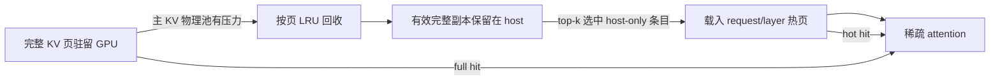

KVDuo 是面向原生稀疏注意力模型的 KV Cache 管理方案。它优先让完整 KV 驻留在 GPU；只有主稀疏 KV 物理池出现分配压力时，才回收已有最新 host 副本的冷页。稀疏注意力再次选中这些页中的条目时，resolver 按 layer 将条目载入 GPU 热页。

这种设计将普通 decode 保持在完整 KV 路径上，并在显存不足后切换为完整页、host 副本和按层热条目共存的混合驻留，从而减少整请求 retract 后重复 prefill 的开销。

## 内存模型

### 统一的 GPU 物理池

KVDuo 在主稀疏 KV 物理池中复用两种 GPU 存储：

- **完整页（full page）**：跨所有稀疏 attention layer 保存一段连续上下文的完整 KV。逻辑位置通过 full-to-physical 映射找到它。
- **热页（hot page）**：整张物理页独占归属一个 `(request, logical_layer)`，保存 resolver 最近需要的条目。

同一页号在所有 C4 存储层上的片段共同组成 KVDuo 的一张物理页。物理页始终处于 `FREE`、`FULL` 或 `HOT(request, logical_layer)` 三种互斥状态之一。KVDuo 不会把同一页号的不同存储层片段分配给不同请求。HOT 页释放后会整页返回通用 allocator，可立即用于新的 FULL 页或另一个 HOT 所有者。

一张 HOT 页的逻辑容量在运行期计算：

```text
K = C4 存储层数 × C4 压缩页大小
```

DeepSeek-V4-Flash-0731 有 21 个 C4 存储层，每层片段包含 64 个槽位，因此一张 HOT 页提供 `K = 21 × 64 = 1344` 个槽位。这里的“物理页”是 KVDuo 对相同页号的管理单位，不要求这些存储层片段位于同一张 CUDA 硬件页。



### 控制面与 CUDA 镜像

控制面维护完整页的 generation、data version、host version、最近访问时间、pin 和所有权。固定地址的 CUDA tensor 镜像向 graph replay 和 fused resolver 提供 full 映射、热页容量、LRU 槽位与统计信息；它们不是第二套所有权来源。

异步 writeback 只有在 generation 和 data version 仍匹配时才能发布 host version。这样，地址复用或原地更新后完成的旧 DMA 不会把过期 host 数据标记为有效。

## 请求生命周期

### 1. Prefill、备份与发布

Prefill 先产生完整 KV，并通过独立 CUDA stream 将数据备份到 pinned host pool。只有写满并完成备份的页才可成为回收候选；正在追加的尾页不会被当作稳定 host 副本。

Chunked prefill 支持保持开启。未完成的 chunk 仍由 request 持有，不会提前发布到 RadixTree；请求完成相应状态转换后，连续且完整驻留的前缀才进入 GPU prefix cache。

### 2. 完整驻留 decode

请求进入 decode 时不会预留热页，也不会为了迁移到 KVDuo 而复制或降级完整 KV。新 token 继续写入完整页；页封口后异步建立 host 副本。只要完整页没有被回收，resolver 直接返回 full 映射。

### 3. 物理池压力与降级

decode 新页、host 前缀恢复或必需热页即将分配时，KVDuo 按实际跨 layer 页字节数检查**主稀疏 KV 物理 allocator**。它不会使用 composite allocator 的最小可用量来推断压力，因为逻辑 token slot、SWA、indexer KV 和 compression state 分别由其他分配路径管理。

发生缺口时，处理顺序如下：

1. 等待需要完成的 producer/writeback 工作，并收集可回收的完整页。
2. 排除 Radix 前缀、当前分配显式保护的位置、请求最新的 `tail_protected_pages` 个页、未写满页，以及 host version 不是最新 data version 的页。
3. 按页内条目的最大最近访问时间执行全局页级 LRU；相同时间使用 request 和页偏移稳定排序。
4. 清除被选页的 full 映射并将物理页返回 allocator；对应请求从此进入混合驻留。
5. 完整页不足时，在成熟且可缩容的 HOT 对象中按尾部命中 EMA 选择 merge。条目 LRU 决定保留集合，物理页选择负责减少搬运量；归还底层 allocator 时使用完整基础页索引范围。

**其他请求的 decode 如何触发回收。** decode 并非每产生一个 token 都需要新的 C4 物理页：当新 token 对应的 C4 条目需要跨入下一页时，调度器才可能面对新增物理页的需求。调度器先尝试淘汰可回收的 RadixTree 缓存，再检查共享的主 C4 物理池。若仍有缺口，先按页级 LRU 回收符合条件的历史 FULL 页；这些候选用尽后，再按 HOT 对象的 EMA 得分选择 merge。每次 merge 将对象缩到 `max(ceil(top_k / K), ceil(n / 2))` 页，存活条目保留原有相对 LRU 顺序，释放的完整页进入共享空闲池。可回收页仍不够时，必需分配进入现有的内存不足处理路径。

**HOT 候选的比较范围。** 同一个 TP rank 的主 C4 物理池内，跨请求、跨逻辑层比较合格对象的 EMA 得分，得分相同则按层号和请求槽位稳定排序。候选必须能释放至少一页、有超过 64 次有效观察，且不受当前使用、搬运或分配保护。正在申请扩容的对象不参与本轮 merge；同一请求的其他合格逻辑层可以参与。HOT 容量始终不低于 `ceil(top_k / K)` 页。

一次真实物理分配只有在压力计划重新检查为 `SUCCESS` 后才能继续。无法取得所需页时会返回明确的压力原因或终止该分配，不会带着部分更新的元数据继续执行。

### 4. 稀疏解析与热页

模型为每层产生 top-k 逻辑位置后，resolver 按以下顺序解析：

- **full hit**：逻辑位置仍有完整页映射，直接使用该物理地址。
- **hot hit**：复用当前 `(request, logical_layer)` 独占热页中的条目，并更新 LRU。
- **host miss**：从该逻辑层的 pinned host 副本载入 KV，优先使用空槽，否则在本轮 top-k 未命中的热条目中按 LRU 选择槽位；换入目标可以位于该 HOT 页的任意 C4 存储层片段。

**热条目的槽位级 LRU。** 对每个 `(request, logical_layer)`，resolver 先找出本轮 top-k 已命中的 HOT 条目，保留其槽位并将它们更新为最近使用；命中 FULL 的位置直接读取完整页，不占 HOT 槽位。其余需要从 host 换入的条目，先复用该请求该层 HOT 页中的空槽；空槽用完后，才按条目级 LRU 替换本轮未被选中的旧条目。被替换条目的 host 副本仍可用，未来再次被选中时可以重新换入。即使该层已达到 `8K` 上限，resolver 仍通过上述槽位替换服务新的 top-k。这一过程只改写已有 HOT 页的条目及槽位映射；归还完整物理页由 replay 边界的 merge 完成。

HOT 页将一个逻辑层的槽位 `j ∈ [0, K)` 编码到连续 C4 backing 中：

```text
storage_layer = j // compressed_page_size
offset        = j % compressed_page_size
flat_location = storage_layer * layer_stride + page_start + offset
```

Host KV 仍按原逻辑层读取；只有 GPU 换入目标通过上述编码分散到不同 C4 存储层。decode resolver 对 FULL 命中加入当前逻辑层的 flat base，对 HOT 员中直接返回全局位置，因此两者可以在同一个索引表中交给 attention。非 decode prefill 的索引仍相对于当前逻辑层，所以普通 FlashMLA prefill 和独立的大 prefill 稀疏路径继续读取 `get_extra_key_buffer(layer_id)`；只有 decode 使用覆盖所有 C4 存储层的扁平 backing。

请求在首次完整页降级前保持零热页容量。进入混合驻留后，下一次 graph replay 前必须为每个逻辑层建立至少 `ceil(top_k / K)` 张 HOT 页。容量只按 `1K、2K、…、8K` 扩缩。例如 DeepSeek-V4-Flash-0731 的模型选择宽度为 512 时，一张 1344 槽 HOT 页已经足够；如果 `top_k > K`，则分配足够的整页容量，超过 `8K` 时启动失败并给出明确错误。

resolver 元数据预先固定为最多 `8K` 个槽位，以保持 CUDA Graph 的指针和形状稳定，但物理页仍按需获取。扩缩容只在 graph replay 之外的允许边界修改映射：

- 请求首次进入混合驻留后，下一次 replay 前补足 `ceil(top_k / K) × K` 的最低容量；`top_k ≤ K` 时为一张 HOT 页。
- 每轮新的 top-k H2D 换入若空槽不足、需要替换已有 HOT 条目，resolver 为该 `(request, logical_layer)` 记录一次容量不足事件。空槽足够、纯 HOT 命中或纯 FULL 命中不触发扩容；同一轮的多个 miss 只产生一次事件。
- 控制面在紧接着的下一次 replay 前消费事件，每次尝试增加一张 HOT 页，最多 `8K`。空闲完整页足够时直接分配；不足时按 EMA 选择其他合格 HOT 对象进行 merge，不依赖累计 miss 数或 miss rate，也不会为可选扩容回收 FULL 页。
- 当前轮先在已有容量内用条目 LRU 完成换入。达到 `8K`，或空闲页不足且没有合格 merge 候选时，暂缓扩容；批次中只有部分对象能取得页时，仍为这些对象扩容。受阻的事件不会延迟重试，后续新的容量不足 H2D 事件可以再次发起扩容。

混合驻留时，每次 replay 前在图外同步读取容量不足事件，确保事件在下一次 replay 前处理；物理页分配后，页首索引批量取回 CPU。GPU 通过页首、存储层偏移和页内偏移的广播批量生成全局位置。CUDA Graph 内部保持固定地址，不执行物理页分配或 CPU 同步。

KVDuo 不为 newest token 暗中保留第九张 HOT 页。混合驻留时，新 token 通过正常的 FULL/HOT 位置解析进入上述容量；旧 HiSparse 路径的额外槽位不计入 KVDuo 的 HOT 页承诺。

### 5. LRU 尾部命中 EMA

每个 `(request, logical_layer)` 只维护一个浮点 EMA 得分 `q` 和一个有效观察步数 `T`。当前容量为 `nK` 时，假设缩容到 `m = max(ceil(top_k / K), ceil(n / 2))` 页，可释放页数为 `F = n - m`。`F = 0` 时不更新统计。

resolver 遍历现有 `lru_slots` 时，以本轮更新前的排名识别 LRU 端前 `FK` 个槽位，统计其中的 HOT 命中数 `B`。物理槽位编号不代表 LRU 排名；FULL/tail 直接命中和 H2D miss 不计入 `B`。统计遵循现有 top-k 批次的访问及 LRU 更新规则。

每个实际执行的 decode 步按 `d = B / F` 更新得分。首次有效观察直接设置 `q = d, T = 1`；随后执行 `q = (1 - alpha) * q + alpha * d, T = T + 1`，默认 `alpha = 1 / 64`。没有尾部 HOT 命中的步骤仍以 `d = 0` 正常更新。padding 请求、capture/warmup 的合成请求及解析失败的步骤不形成有效观察。

扩容保留 `q` 和 `T`，下一轮按新容量计算 `F`。缩容或 merge 完成后通过统一重置入口清零该对象的统计；请求结束、撤回或请求槽位复用也会清零。重置在设备 stream 上排在旧 decode producer 之后，避免旧请求的排队计算写入新请求的统计。

得分和步数由 GPU resolver 在固定地址上直接更新，正常 decode 不为 EMA 增加 GPU→CPU 同步。只有发生回收需求时，控制面在安全边界同步读取候选统计及真实缓存元数据；快照仅用于当前边界，不跨请求槽位复用保存。若后续引入异步 host 统计快照，应用结果前必须验证请求 generation。

得分的单位为“命中条目数／释放页／decode 步”，衡量近期真实 LRU 待截掉区域的贡献。它不模拟缩容后的多步缓存演化，也不保证实际损失的上界或下界。

### 6. 按单位页损失选择与执行 merge

在合格对象中直接选择 `q` 最小的对象，不再次除以可释放页数，也不按剩余缺口调整得分。默认要求 `T > T_min`，其中 `T_min = 1 / alpha = 64`，因此第 65 次有效观察之后才可参与选择。观察不足不能视为零损失。这个门槛与 EMA 响应采用同一步数尺度，但不是统计置信度保证。当前比较限于条目大小相同的主稀疏 KV 池；若将来跨不同条目大小比较，应按释放字节数归一化。

例如对象 A 从 `8K` 缩到 `4K`，`q=0.5`；对象 B 从 `4K` 缩到 `2K`，`q=0.75`。即使只缺一页，仍先选 A，释放的四页统一进入空闲池，供当前和后续分配使用。

对选中的对象，merge 执行以下步骤：

1. 从真实 LRU 的 MRU 端保留最多 `mK` 个有效条目；有效条目不足时全部保留。
2. 留下包含最多保留条目的 `m` 个物理页，同数时按原页序稳定选择，以减少搬运量。
3. 将释放页中的存活条目复制到留下页的空槽或被丢弃条目占用的槽位，更新条目与物理地址映射。C4 复制同时保留值和 scale 字节，并支持跨存储层片段搬运。
4. 按原 LRU 的相对顺序排列存活条目，将空槽放在 LRU 端优先使用；清空容量外的 token、location、LRU 和页元数据，发布新容量。
5. 清零该对象的 `q/T`。确认旧 decode、待完成的 KV 搬运和本次复制及元数据更新完成后，将释放页归还 allocator。

搬运不计为一次访问，不会统一刷新存活条目为最近使用，也不会按物理槽位编号重建有效条目的 LRU。复制失败时不会释放源页或继续当前分配。

每次 merge 后重新检查空闲页数；仍有缺口时在其余合格对象中继续按原始 `q` 选择。剩余需求仅决定何时停止。已 merge 的对象统计归零，重新积累超过门槛的有效观察前不能再次 merge，因此同一轮不会反复缩小它。所有分配、搬运和释放均在 decode 步之间执行，resolver 元数据的地址与形状保持固定。

### 7. Prefill 准入与增量页快速回收

现有调度器仍决定请求顺序、分块和组批。KVDuo 在 chunk 和 host 前缀恢复范围确定后，检查主稀疏 KV 池所需的实际物理页，计入同轮其他 prefill 的预留及尚未补足的必需 HOT 容量。空间足够时正常准入；不足时完整规划快速回收，没有合格方案则保留请求等待，让 decode 推进。

每次 merge 保留的物理页建立基础容量 `aK`。随后扩容只追加增量页，基础页内容继续正常参与条目 LRU 替换。resolver 按物理槽位是否位于 `[0, aK)`，区分基础页和增量页命中；这与 LRU 排名无关，也不恢复 merge 时的历史 KV 或 LRU。

每个实际 decode 步维护四个计数的 EMA：有效访问 `D`、FULL/tail 直接命中 `H_direct`、基础页 HOT 命中 `H_base`、增量页 HOT 命中 `H_extra`。H2D 换入不计为命中；padding、无效访问和解析失败的步骤不形成有效观察，零命中步骤正常更新。使用同一个 `alpha=1/64`，首次观察直接初始化。当前 miss EMA 由 `M=D-H_direct-H_base-H_extra` 得到。

merge 后清零统计，在基础容量下实际观察命中率。首次扩容冻结参考命中率 `h_ref` 和观察步数，并重新开始当前评估阶段；继续扩容保留当前统计。两个阶段都必须积累超过 64 次有效观察。过早扩容的对象缺少成熟参考，不能当作零损失候选。

唯一准入参数 `max_relative_miss_increase` 默认 `0.10`，记为 `rho`。候选必须有增量页、请求仍活跃、未处于 staging、保护或扩容限制状态，且保留基础页后仍满足最低容量，并同时满足：

```text
H_extra <= rho * M
D - H_direct - H_base <= (1 + rho) * (1 - h_ref) * D
```

第一式限制预计 miss 相对增幅，第二式检查基础容量相对于 merge 后参考的稳定性。当前 miss 为零时，仅允许 `H_extra=0`。不设置固定命中率下限或隐含容差。合格对象按 `H_extra / (b-a)` 升序选择，同分按对象顺序稳定处理，不按剩余缺口修正得分。

连续准入共用一轮固定预算。首次成功快速回收前，记录活跃 decode 对象的参考 miss `M0`；每个回退对象记录当时的增量命中代价 `E`。后续新增方案必须满足 `sum(E) + sum(new H_extra) <= rho * sum(active reference M0)`。已预留代价不随 EMA 衰减，后加入的请求不扩大预算，也不能在这一轮成为新候选。请求结束时移除其参考 miss 和代价；解除某对象限制时移除其代价；所有限制解除后结束本轮。host 记录绑定请求槽位 generation，槽位复用清空旧状态。

只有完整方案同时满足空间与预算条件后才执行释放，不先回收部分对象。一次批量 GPU metadata kernel 为每个对象启动一个 CTA，通过前缀和稳定过滤旧 LRU 中 `slot<aK` 的槽位。基础条目不搬运、不重新编号，空槽优先和存活条目的相对顺序保持不变。清空容量外的 token、location、LRU 和页元数据，发布基础容量；确认旧 decode、在途搬运及本次更新完成后统一归还增量整页。graph 捕获的张量地址、形状和 stride 保持固定。

释放前先建立本次 prefill 的物理页预留和对象扩容限制。其他可选扩容只能使用未预留空间。回退对象清零尾部损失 `q/T`、当前贡献计数及观察步数，保留历史参考和本轮预留代价；正常执行 H2D 和条目 LRU，但不响应扩容事件，也不参与可选 merge。取消准入会撤销预留和相关限制，已经丢弃的 KV 不主动恢复。

完成 prefill 分配后撤销该次物理页预留；对象限制仍保留，直到没有对应预留且物理池存在可选扩容余量。解除限制丢弃受限期间的事件，只允许后续新事件触发扩容，不立即恢复旧容量。Prefill 计算完成本身不释放新请求持有的 KV。

例如，参考基础命中率为 80%，当前总体命中率为 83%，基础与直接命中贡献仍为 80%：释放增量页会让 miss 从 17% 增至 20%，相对增加约 17.6%，不满足默认预算。若总体为 81%、基础贡献为 80%，预计 miss 从 19% 增至 20%，相对增加约 5.3%；观察、稳定性、空间及本轮累计预算均满足时可以回退。

### 8. 策略依据与限制

尾部命中数除以可释放页数越小，说明近期这部分容量每页贡献的 HOT 命中越少。该策略倾向于回收超出近期热工作集需求的容量，以及低复用访问场景中贡献较少的容量，无需额外维护倾斜度、随机 top-k 检测、滑动窗口或独立 What-if 缓存。

历史观察的权重经过 `k` 次有效更新后按 `(1 - alpha)^k` 衰减。扩容保留 EMA 和观察步数，因此得分可能混合不同容量阶段的单位页损失。它是近期缩容代价的平滑代理，不等于当前容量减半后的精确命中损失，也不保证未来访问的收益，需要离线回放和在线实验验证。

Prefill 快速回收同样使用估计：基础页与增量页共同运行时的条目演化，不等于基础容量单独运行。严格遵守 miss 预算不代表能够严格保证未来命中率或 SLO。

本设计借鉴 [Utility-Based Cache Partitioning（UCP）](https://www.eecs.northwestern.edu/~rjoseph/eecs453/papers/quereshi-micro2006.pdf) 按缓存资源收益分配空间的思想，使用真实 HOT 缓存的 LRU 尾部命中 EMA，不采用独立的效用监测缓存。

## Host 前缀缓存与恢复

RadixTree 只表示连续 GPU 前缀，不能表示中间含 host-only 空洞的请求。KVDuo 另外维护容量受限的 host prefix cache：

- 页 identity 由 namespace、父页 identity 和当前 token chunk 构成，可在请求槽位复用后继续标识内容。
- record 保存每个 KV domain 的 host 地址与版本，并分别跟踪 request 引用、cache 引用、restore pin 和 DMA pin。
- 无引用且无 pin 的 record 才能按 LRU 淘汰；前缀匹配沿连续且版本有效的页链扩展，遇到第一个缺页或旧版本即停止。

host-only 命中不会直接交给 attention。调度器先为恢复建立 commitment 并 pin 住源 record，然后为缺失的完整页预留 GPU 资源、执行 H2D、发布 full 映射，最后释放 restore pin。资源暂时不足时恢复会延后，避免暴露半恢复的前缀。

Tensor parallel 场景下，各 rank 的 GPU 与 host 淘汰可能不同。KVDuo 会协商所有 rank 都能达到的 host 前缀终点；如果仅 GPU 命中长度不同，则重新匹配共同 GPU 前缀。所有 rank 最终以相同前缀长度进入执行。

请求结束时，只有连续、完整且版本有效的页能保留为 host 前缀。混合请求中 RadixTree 无法表达的 request-owned GPU 碎片会被释放。

## 不变量与管理边界

当前实现依赖以下不变量：

- 只有完整、页对齐、host 副本版本最新且未受保护的 full page 可以回收。
- 每张物理页只有一个 `FREE`、`FULL` 或 `HOT(request, logical_layer)` 状态；不同请求或逻辑层不能共享同一页的存储层片段。
- 完整驻留请求不持有投机热页；混合请求在 replay 前必须拥有至少 `ceil(top_k / K)` 张完整 HOT 页。
- FULL 页优先于可选 HOT 页成为压力牺牲者；HOT 容量不能缩到必需整页下限以下，且最多为八张页。
- prefill 的层内索引只读取当前逻辑层 view；decode 的 FULL/HOT 全局索引只读取扁平 C4 backing。
- prefix restore 期间源 host record 被 pin，发布前不能被淘汰。
- KVDuo 只解决主稀疏 KV 物理池压力；其他资源短缺仍由对应 allocator 或 scheduler 处理。

KVDuo 复用 HiSparse 的 host pool、稀疏 selector、resolver 和部分 allocator 接口，但改变了驻留策略：HiSparse 的共享配置由 KVDuo 在启动时生成，完整 KV 不会从一开始就被限制在固定 device buffer 中。

## 适用场景与限制

适合：

- 原生支持稀疏 KV 选择和当前 resolver/backend 的模型；
- 长上下文、高并发 decode，且主要瓶颈是主稀疏 KV 物理池；
- 工作集具有时间局部性，host pinned memory 容量和 H2D 带宽足够；
- 希望用页级降级代替整请求 retract 和重复 prefill。

不适合：

- 稠密注意力模型或没有受支持 selector/backend 的模型；
- 短上下文、低并发，完整 KV 可长期驻留 GPU；
- 瓶颈来自权重、计算、workspace、逻辑 token、SWA、indexer KV 或 compression state；
- 必须使用 speculative decoding、HiCache 或关闭 Radix cache。

## 启动与配置

在 NVIDIA CUDA 环境中，将 `MODEL_PATH` 替换为受支持的稀疏注意力模型：

```bash
python3 -m sglang.launch_server \
    --model-path MODEL_PATH \
    --tp-size 8 \
    --enable-kvduo \
    --kvduo-config='{"top_k": 2048, "host_to_device_ratio": 2, "swap_in_block_size": 960, "tail_protected_pages": 2}'
```

| 参数 | 默认值 | 作用 |
| --- | ---: | --- |
| `top_k` | `2048` | 每层 resolver 返回的选择宽度，不决定单页大小。实际最小 HOT 页数为 `ceil(top_k / K)`；DeepSeek-V4-Flash-0731 的模型 `index_topk` 为 512。 |
| `host_to_device_ratio` | `2` | host pool 相对 device pool 的容量比例。 |
| `swap_in_block_size` | `960` | resolver CUDA thread block 的线程数，不是一次 H2D 搬运的 KV 条目数；范围为 1–1024。 |
| `tail_protected_pages` | `2` | 每个请求不参与完整页回收的最新页数量。 |
| `max_relative_miss_increase` | `0.10` | Prefill 快速回收允许的预计 miss 相对增幅；有限非负数，不与 EMA 的 `alpha` 绑定。 |

前四个字段必须是正整数；`max_relative_miss_increase` 可以是非负整数或小数。未知字段会报错。默认 `0.10` 是实验起点，尚未经在线实验确定为最优值。`--kvduo-config` 必须与 `--enable-kvduo` 一起使用。

KVDuo 要求启用 RadixTree，且不能与 `--enable-hisparse`、`--enable-hierarchical-cache` 或 speculative decoding 同时启用。KVDuo 支持 chunked prefill；启用它不会改写 `--chunked-prefill-size`。

## 评估重点

逐步增加上下文长度和并发，并同时观察：

- token throughput、TTFT、TPOT 和端到端延迟；
- retract/preemption 与重复 prefill token 数；
- FULL 页、按 `(request, logical_layer)` 独占的完整 HOT 页和 host pool 的占用；
- full/hot/host 命中分布、resolver host miss rate 和 H2D 带宽；
- 因主 KV 之外的资源不足导致的 admission 失败。

如果并发容量没有提高，先确认限制来自主稀疏 KV 物理池。如果 host miss rate 持续偏高，再检查 top-k 的时间局部性、热页可选扩容是否受物理压力限制，以及 H2D 是否成为瓶颈。
